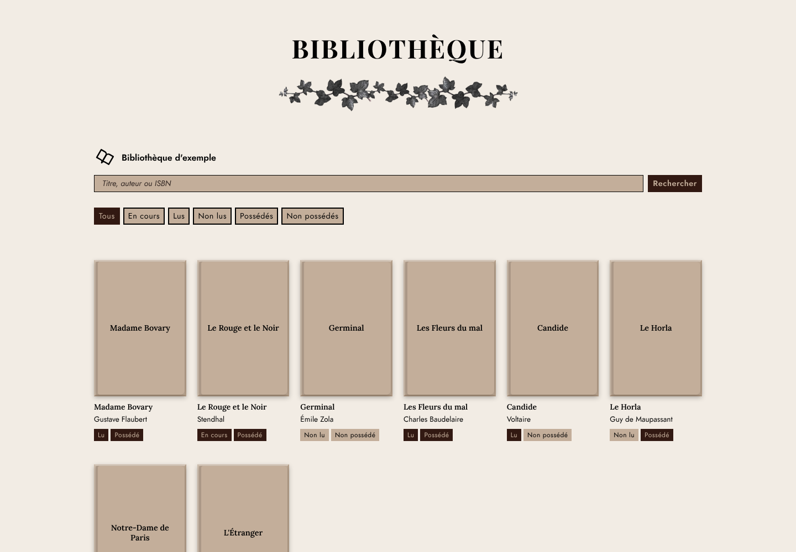
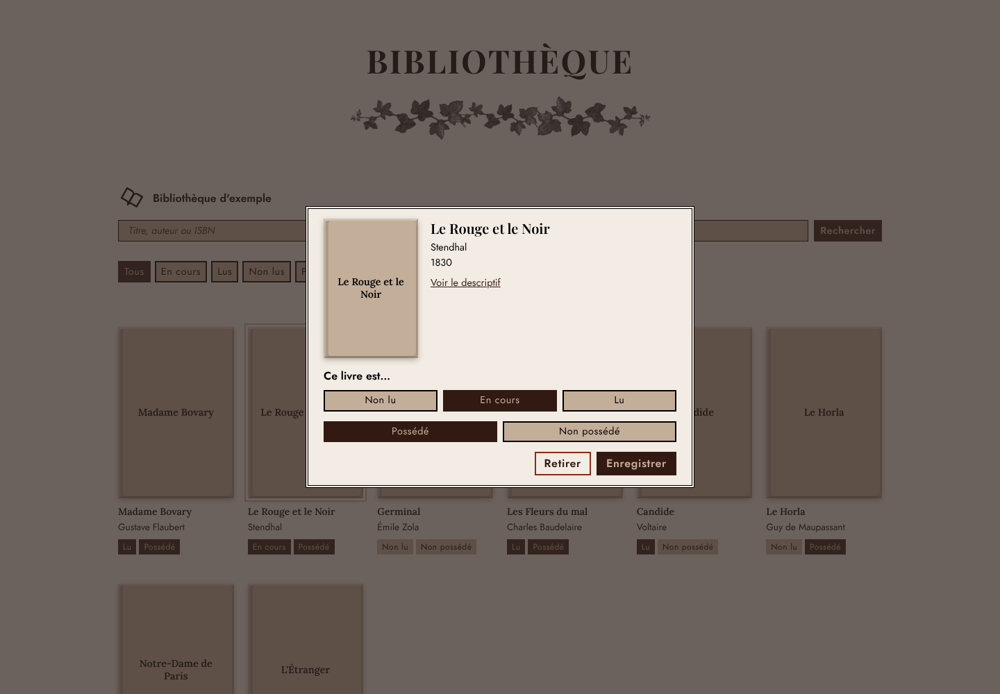

# Ma bibliothèque

Application web de bibliothèque virtuelle : on cherche un livre, on l'ajoute, puis on suit son état de lecture (non lu, en cours, lu) et s'il est possédé ou non. Plusieurs bibliothèques peuvent coexister.

**Démo** : <https://katerinamysh.github.io/virtual-library/>



## Fonctionnalités

- **Recherche** par titre, auteur ou ISBN avec l'API [Google Books](https://developers.google.com/books), avec jusqu'à 5 tentatives automatiques (et une requête allégée) si le service est momentanément indisponible.
- **Résultats par lignes complètes** : 4 lignes à la fois, quel que soit le nombre de colonnes de l'écran, puis un bouton « Afficher plus de résultats ». Seule la dernière page, quand il n'y a plus rien à charger, peut avoir une ligne incomplète.
- **Couvertures** : Open Library par ISBN en priorité, puis Google Books, puis le titre sur fond neutre.
- **Recherche dans sa bibliothèque** : un second bouton, « Ma bibliothèque », filtre les livres déjà ajoutés par titre, auteur, année ou ISBN (sans tenir compte des accents ni des majuscules), en combinaison avec les filtres de lecture.
- **Détection des doublons** : avant d'ajouter un livre, une fenêtre montre la fiche d'un livre similaire déjà présent (même ISBN, ou même titre et auteur commun, même pour une autre édition) et demande confirmation.
- **Fiche d'un livre** : couverture, titre, auteur, année et descriptif à la demande.
- **Suivi de lecture** en deux temps : non lu, en cours ou lu, puis possédé ou non possédé.
- **Filtres** : tous, en cours, lus, non lus, possédés, non possédés. Un second clic sur le filtre actif revient à « Tous ».
- **Plusieurs bibliothèques** : création, renommage et suppression, avec un menu accessible au clavier (flèches, Échap).
- **Interface en français et en anglais** (boutons FR / EN, langue du navigateur détectée à la première visite). La recherche, elle, n'est limitée à aucune langue : on peut ajouter des livres dans n'importe quelle langue, quelle que soit celle de l'interface.
- **Export et import** : depuis le menu du logo, on télécharge toutes ses bibliothèques dans un fichier `.json` (avec la date de la dernière sauvegarde), puis on l'importe sur un autre appareil en choisissant de fusionner ou de remplacer. Le fichier importé est vérifié et nettoyé (champs connus, tailles limitées, couvertures en `https` uniquement).
- **Sauvegarde locale** dans le navigateur (`localStorage`) : aucune donnée n'est envoyée à un serveur.



## Choix techniques

- **HTML, CSS et JavaScript sans framework ni étape de compilation.** Le site est un ensemble de fichiers statiques.
- **Mise en page par grille CSS** : jusqu'à 6 livres par ligne, titres, auteurs et pastilles alignés d'une carte à l'autre grâce à `subgrid`, avec un gabarit de repli et des points de suspension pour les textes longs.
- **Accessibilité** : navigation au clavier, rôles ARIA du menu, états `aria-pressed`, respect de `prefers-reduced-motion`.
- **Polices hébergées dans le site** (Playfair Display, Lora et Jost, sous licence SIL Open Font) : aucune requête vers un service de polices tiers.
- **Données de démonstration** : à la première visite, une bibliothèque d'exemple s'affiche (`demo.js`).

## Lancer le projet

Aucune installation n'est nécessaire. Ouvrez `index.html` dans un navigateur, ou lancez un serveur local :

```bash
python3 -m http.server 8000
```

puis ouvrez <http://localhost:8000>.

## Clé API Google Books (facultative)

La recherche fonctionne sans clé, mais Google peut limiter les requêtes anonymes. Pour utiliser une clé, renseignez-la dans `config.js` :

```js
window.APP_CONFIG = {
  googleBooksApiKey: "VOTRE_CLE"
};
```

Sur un site public, une clé est visible par tous les visiteurs. Utilisez une clé dédiée, restreinte au domaine du site (restriction « Websites », par exemple `https://votre-compte.github.io/*`, car le navigateur n'envoie que le domaine) et à l'API Books, avec un quota quotidien. Ne publiez jamais une clé non restreinte.

## Structure

```
index.html      page et fenêtres
style.css       styles et polices
script.js       logique de l'application
demo.js         bibliothèque d'exemple (FR / EN)
i18n.js         traductions de l'interface
config.js       configuration (clé API facultative)
fonts/          polices hébergées et leurs licences
docs/           captures d'écran du README
```

## Licence

Code publié sous licence [MIT](LICENSE). Les polices du dossier `fonts/` sont sous licence SIL Open Font (voir les fichiers `LICENSE-*.txt`). L'image `separateur.webp` a été créée sur Canva et n'est pas couverte par la licence MIT.

## Limites connues

- Les données sont liées au navigateur : changer de navigateur ou vider ses données efface la bibliothèque. L'export et l'import de fichier permettent de les transférer ou de les sauvegarder, sans synchronisation automatique.
- La recherche dépend de la disponibilité de l'API Google Books, qui répond parfois par une erreur 503.
